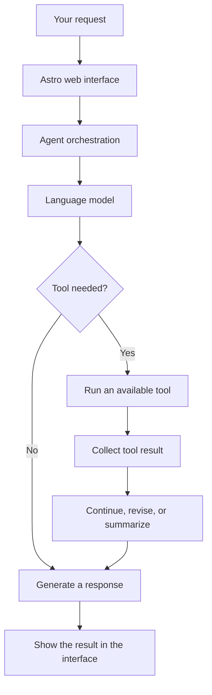

# 🌌 Astro AI Agent

**A local-first AI assistant that can think through tasks, use tools, work with your files, automate a browser, and remember useful information across conversations.**

Astro AI Agent is designed to be more than a text-only chatbot. Through a web interface, you can ask Astro to help with everyday research, development tasks, project files, and browser workflows. Depending on your configuration and the model you connect, Astro can plan a task, use available tools, report the results, and keep selected information in local memory.

Astro runs its application server on your own machine. You choose the language-model endpoint it connects to, the workspace it can work in, and how you use its tools. You can connect an OpenAI-compatible endpoint such as OmniRoute or another supported provider. A locally hosted model can also be used when it exposes a compatible API.

> **Important privacy note:** Astro is designed to be local-first, but privacy depends on your configuration. The web server, workspace, and SQLite memory can run locally. If you connect a remote model provider, prompts and the context sent to that provider leave your computer and are processed according to that provider's policies. For a fully local inference setup, configure Astro to use a compatible model server running on your machine and verify that your browser and other tools do not contact remote services unexpectedly.

---

## Contents

- [Why Astro?](#-why-astro)
- [Key Features](#-key-features)
- [How Astro Works](#-how-astro-works)
- [Architecture Overview](#-architecture-overview)
- [Requirements](#-requirements)
- [Installation](#-installation)
- [Configuration](#-configuration)
- [Running Astro](#-running-astro)
- [Using Astro](#-using-astro)
- [Example Prompts](#-example-prompts)
- [Browser Automation](#-browser-automation)
- [Workspace and File Access](#-workspace-and-file-access)
- [Long-Term Memory](#-long-term-memory)
- [Models and Providers](#-models-and-providers)
- [Image Understanding](#-image-understanding)
- [Privacy and Security](#-privacy-and-security)
- [Project Structure](#-project-structure)
- [Troubleshooting](#-troubleshooting)
- [Limitations](#-limitations)
- [Roadmap](#-roadmap)
- [Contributing](#-contributing)
- [License](#-license)

---

## 🌠 Why Astro?

Many chatbots can explain how to complete a task, but they cannot directly interact with your local development environment. Astro is built around the idea that an assistant should be able to do more than generate text: it should be able to use tools to help carry out a task, then show you what happened.

For example, you could ask:

> Research the basics of UEFI memory maps, write a short summary to `notes/uefi-memory-map.md`, and tell me which file you created.

A tool-enabled workflow can break that request into smaller operations, use the configured model to decide what to do, write the requested file inside an available workspace, and report the result. The exact actions available depend on the tools enabled in your installation and the abilities of the model you configure.

Astro is intended for people who want more control over their assistant: developers, students, researchers, Linux users, and anyone who wants to experiment with local-first AI workflows.

## ✨ Key Features

### 🤖 Multi-model support

Astro connects to an OpenAI-compatible chat-completions endpoint. You can use a routing service such as OmniRoute or another compatible provider. The available models depend on the endpoint, provider account, and provider configuration; a number such as “1,492+ models” describes possible provider coverage, not a guarantee that every model is available in every setup.

### 🧩 Planner and Executor workflow

For supported multi-step tasks, Astro can use a planning stage to break a request into smaller steps and an execution stage to perform those steps with available tools. This makes the work easier to follow than a single large response. The quality of planning, execution, recovery, and verification depends on the model, the prompt, and the tools available.

### 🌐 Real browser automation

Astro uses Playwright to control a Chromium browser. Depending on the implemented browser tools, it can navigate to pages, interact with page elements, enter text, scroll, and capture screenshots. This is useful for websites whose content is rendered with JavaScript, but it does not guarantee that every website or login flow will work automatically.

### 📁 Workspace-aware file operations

Choose a project directory and ask Astro to help inspect or modify files within the paths available to its tools. The workspace setting helps you direct Astro toward the project you want to work on. Always review generated code and important file changes before using them in a real project.

### 🧠 Long-term memory with SQLite

Astro includes a local SQLite-based memory component for storing useful facts. This can help it retain selected information between sessions, such as project context or preferences. Memory is not a perfect transcript of every conversation, and you should avoid saving passwords, API keys, private tokens, or other secrets.

### 🖼️ Image understanding

You can provide images for analysis when the selected model supports vision and the application path you use accepts image input. Vision support depends on both the model and its endpoint; text-only models cannot interpret image content reliably.

### 🌍 Bilingual interface

The interface supports English and Indonesian, making Astro more accessible to users who prefer either language.

### 🛑 Stop generation

The interface includes a stop control to interrupt a response while it is streaming. Stopping a response does not necessarily undo a command or file operation that has already completed.

### ⚙️ Settings and quick modes

Astro includes a settings interface and quick modes intended to make common configurations easier to manage. The exact options available may depend on the current version of the project.

---

## 🧭 How Astro Works

A typical tool-assisted request follows a workflow like this:



### 1. You describe the goal

Write a request in ordinary language. For example, ask Astro to inspect a project directory, look up a page in the browser, or create a note.

### 2. The model interprets the request

Astro sends the relevant input to the configured language model. If the task needs multiple steps, the agent workflow can plan those steps before performing supported actions.

### 3. Astro uses available tools

The agent may use a browser tool, a file operation, a terminal command, or another tool registered in the application. The available tools and their permitted operations determine what Astro can actually do.

### 4. Results are returned to the agent

Tool output is used to inform the next step or the final response. The model can still make mistakes or misunderstand output, so important results should be checked independently.

### 5. Astro reports the outcome

The interface displays the response and, where available, relevant tool results. You remain responsible for reviewing changes that affect your system, files, accounts, or other important resources.

---

## 🏗️ Architecture Overview

Astro is a Python application with a web backend and a browser-based frontend. The main parts currently documented in the repository are:

| Component | Responsibility |
| --- | --- |
| `web/server.py` | Starts the web server and connects the frontend to the backend. |
| `web/static/` | Contains the web interface's static assets. |
| `6_agent/chat.py` | Handles the main chat orchestration logic. |
| `6_agent/multi_agent.py` | Implements the Planner + Executor workflow. |
| `6_agent/browser_agent.py` | Provides browser automation through Playwright. |
| `6_agent/memory.py` | Implements SQLite-based long-term memory. |
| `6_agent/tools.py` | Holds the tool registry and related tool functionality. |
| `6_agent/config.py` | Loads application configuration. |
| `.env.example` | Provides an example environment configuration. |
| `requirements.txt` | Lists Python dependencies. |

The project directory name `6_agent` is intentional in the current source tree; use the name that exists in your checkout rather than renaming it based only on this documentation.

### Planner, Executor, and tool calls

The planning stage helps organize a task into smaller actions. The execution stage uses the available tools to perform supported operations, such as interacting with files or a browser. This is not a guarantee of fully independent or error-free behavior: models can produce incorrect plans, and a tool can fail or be blocked by a website or operating-system permission.

---

## 💻 Requirements

### Software

- **Python 3.10 or newer**
- **Git** to clone the repository
- **A Linux environment** — Linux, including Arch Linux, is the primary documented target
- **An OpenAI-compatible chat-completions endpoint**, such as OmniRoute or another compatible API
- **Playwright and Chromium** for browser automation
- A modern web browser to open the local interface

Other operating systems may work with adjustments, but they are not the primary documented target. Installation steps and system package names can differ across distributions.

### Hardware

| Resource | Recommendation |
| --- | --- |
| RAM | 8 GB or more for general use; 16 GB or more is more comfortable for heavier workloads or local inference. |
| Storage | Enough space for the Python environment, browser runtime, logs, memory database, workspace, and any local models. |
| CPU | A modern multi-core CPU is recommended for a smoother experience. |
| GPU | Not required by Astro itself. A GPU may help if your selected local model server uses GPU acceleration. |
| Internet connection | Needed for remote model providers and many online browser tasks. Not inherently required for a completely local model and offline workflow. |

**Note:** Hardware requirements vary significantly with the model and workload. Running Astro locally does not mean every model runs locally; a remote API can do the model inference while Astro's application server remains on your machine.

---

## 🚀 Installation

These steps describe the repository's current basic startup flow. Commands may need small changes depending on your Linux distribution and Python packaging policy.

### 1. Clone the repository

```bash
git clone https://github.com/astrix-kernel/astro-agent.git
cd astro-agent
```

### 2. Create a Python virtual environment

A virtual environment keeps the project's Python packages separate from your operating system's Python installation. It is recommended on distributions that protect system-managed Python packages.

```bash
python3 -m venv .venv
source .venv/bin/activate
```

If the `venv` module is unavailable, install the appropriate Python virtual-environment package for your distribution and repeat the command.

On Windows, virtual-environment activation uses a different path, but Windows is not the primary documented target for this repository.

### 3. Install Python dependencies

```bash
python -m pip install --upgrade pip
python -m pip install -r requirements.txt
```

### 4. Install the Playwright Chromium browser

```bash
python -m playwright install chromium
```

On Linux, Playwright may report missing operating-system libraries. Follow the installation instructions shown by Playwright for your distribution. Install system dependencies only from sources you trust.

### 5. Create your local environment file

```bash
cp .env.example .env
```

Open `.env` in your preferred text editor and configure your model endpoint and workspace. For example:

```dotenv
# OpenAI-compatible chat-completions endpoint
LLM_URL=http://localhost:20128/v1/chat/completions
LLM_API_KEY=replace-with-your-key

# Directory Astro should use as its default workspace
ASTRIX_WORKSPACE=/home/yourname/projects

# Web server settings
ASTRIX_PORT=8765
ASTRIX_HOST=127.0.0.1
```

Replace `/home/yourname/projects` with a directory that exists on your machine. The endpoint above is an example default for a local routing service; use the correct URL and key for your actual provider.

**Keep `.env` private.** Do not commit API keys, passwords, access tokens, or other secrets to Git. The repository's `.gitignore` should protect local configuration, but check your Git status before making a commit.

### 6. Start Astro

```bash
python3 web/server.py
```

If startup succeeds, open the local interface at:

**http://localhost:8765**

Keep the terminal open while using Astro. To stop the server, use `Ctrl+C` in the terminal where it is running.

---

## ⚙️ Configuration

Astro reads its environment settings from `.env` according to the configuration code in the project. The following settings are documented by the current repository README and example file.

| Variable | Example / default | Purpose |
| --- | --- | --- |
| `LLM_URL` | `http://localhost:20128/v1/chat/completions` | URL of the OpenAI-compatible chat-completions endpoint. |
| `LLM_API_KEY` | Provider-specific value | Key or credential value expected by the configured endpoint. Use a placeholder only in examples. |
| `ASTRIX_WORKSPACE` | `~/` or a project path | Default folder for project and file-related tasks. Set it to a specific working directory when possible. |
| `ASTRIX_PORT` | `8765` | Port used by the web server. |
| `ASTRIX_HOST` | `0.0.0.0` in the example configuration | Network interface on which the server listens. |
| `ASTRIX_LOG_DIR` | `./logs/` where supported | Log directory, if enabled in your current code version. |

### Choosing a host address

For a local-only setup, use:

```dotenv
ASTRIX_HOST=127.0.0.1
ASTRIX_PORT=8765
```

Binding to `127.0.0.1` normally makes the interface available only from the same computer. Binding to `0.0.0.0` can expose the server on network interfaces beyond the local loopback interface, depending on your firewall and network. Do not expose the server to a public network unless you have reviewed its authentication, access controls, and security implications.

### Choosing a workspace

Use a dedicated directory for projects you want Astro to work on. For example:

```dotenv
ASTRIX_WORKSPACE=/home/yourname/Projects
```

The configured workspace is a starting point, not a substitute for checking the actual paths used by a tool. Keep backups of important files and avoid pointing an agent at sensitive directories unless you understand exactly what its tools can access.

---

## ▶️ Running Astro

After setup, the normal startup sequence is:

```bash
cd astro-agent
source .venv/bin/activate
python3 web/server.py
```

Then open `http://localhost:8765` in your browser.

If you open another terminal to run commands, remember to activate the same environment before invoking Python commands related to the project. If the server reports that a port is already in use, either stop the other process or choose a different `ASTRIX_PORT` value in `.env`.

---

## 🧑‍🚀 Using Astro

### Start with a small task

Begin with a request that has an obvious result and limited side effects. For example, ask Astro to explain a concept, summarize a public page, or write a short note in a test directory.

### Be specific about the result

A good request explains:

1. **The goal** — what you want to accomplish.
2. **The scope** — which website, project, or directory is relevant.
3. **The output** — whether you expect a summary, a file, a code change, or a report.
4. **The restrictions** — any files or actions that must not be changed.

For example:

> Inspect the Python files in `/home/yourname/Projects/demo`, identify the main entry point, and summarize the project structure. Do not modify any files.

This is easier to interpret than “Check my project.”

### Review the results

Treat model output as a useful assistant's work, not as unquestionable truth. Read important file changes, inspect commands that were run when possible, and run tests before relying on generated code.

---

## 💬 Example Prompts

The examples below illustrate the kind of request you can try. Results depend on the current implementation, configured model, enabled tools, website behavior, and permissions.

### Browser research

```text
Open https://en.wikipedia.org/wiki/Linux, read the page, and summarize its main points.
```

### Navigate and click

```text
Open https://example.com and click the link labeled "More information" if it is present.
```

### Create a text file

```text
Create /tmp/astro-notes.txt with the following content:
Hello from Astro AI Agent.
Then tell me the path of the file you created.
```

Use a temporary or test directory when first experimenting with file-writing tools.

### Inspect a directory

```text
List the files in /tmp, group them by file type, and give me a short summary.
Do not delete or change anything.
```

### Run a simple command

```text
Run `ls -la` in /tmp and explain what the output means.
Do not run any additional commands.
```

Only try terminal-related prompts if terminal execution is enabled in your installation. Commands can change your system, and a language model may misunderstand a request.

### Save useful context in memory

```text
Remember that I am working on a Python project named DemoApp.
The main goal is to build a small REST API.
```

Memory behavior depends on how the memory tool and current agent flow are implemented. Do not use this feature to store secrets or sensitive information.

---

## 🌐 Browser Automation

Astro uses Playwright to automate a Chromium browser. Browser automation can help with research, navigation, form interaction, and pages that render content with JavaScript.

Depending on the current browser-tool implementation, supported actions may include:

- Opening a URL
- Clicking a page element
- Entering text into a field
- Scrolling a page
- Capturing a screenshot
- Reading visible page content for a summary

### Browser automation tips

- Use a clear URL and a specific goal.
- Ask Astro to summarize what it found rather than assuming every page will load successfully.
- Be especially careful on pages that submit forms, purchase items, delete records, send messages, or change account settings.
- Do not ask Astro to enter passwords or sensitive personal information into websites unless you have reviewed the consequences and trust the destination.
- Some websites use bot detection, CAPTCHAs, rate limits, or login flows that may prevent automation.
- A screenshot shows what the browser rendered; it does not prove that every detail on the page was interpreted correctly.

Playwright being installed does not mean every website interaction is supported. The available browser tools and website restrictions determine what can be automated.

---

## 📂 Workspace and File Access

The workspace setting points Astro toward a default project directory for file-related work. This can help you use Astro as a coding assistant, research helper, or project organizer.

Possible workflows include asking Astro to:

- Explain a codebase's directory structure
- Summarize selected source files
- Draft documentation
- Create notes or reports
- Help investigate an error log
- Suggest or make changes to project files when the relevant tools are enabled

### File safety recommendations

1. Keep a backup or use Git before asking Astro to modify a project.
2. Begin with read-only tasks while you are learning the tool.
3. Ask for exact paths and a summary of changes.
4. Review generated code before executing it.
5. Avoid giving an agent access to directories containing credentials, private keys, browser profiles, or unrelated personal files.
6. Use a disposable test directory to learn which file operations are available.

The workspace setting should not be treated as a security sandbox. File access depends on the implementation and operating-system permissions of the process running Astro.

---

## 🧠 Long-Term Memory

Astro includes an SQLite-based memory component for facts intended to remain useful between conversations. This is different from keeping a full, searchable transcript of every chat.

### Useful things to remember

- The name and purpose of an ongoing project
- Preferred programming languages or tools
- Non-sensitive formatting preferences
- A short summary of work in progress

### Things you should not store

- Passwords or API keys
- Recovery codes or authentication tokens
- Private encryption keys
- Financial account information
- Sensitive personal information that is not needed for the task

Memory may be incomplete, outdated, or interpreted incorrectly. Verify important remembered details and check the current implementation before assuming that every statement is stored, retrieved, or deleted exactly as expected.

---

## 🧠 Models and Providers

Astro is designed to connect to a compatible chat-completions endpoint rather than requiring one specific model to be bundled with the application. This lets you choose a provider based on availability, capability, performance, privacy requirements, and cost.

### Remote model provider

A remote provider can offer access to models without requiring you to download them. This is often easier to configure, but prompts and context sent to the provider are transmitted outside your computer. Review the provider's data-handling policy before using sensitive material.

### Local model endpoint

A model served on your own machine can reduce reliance on remote inference. To use one, configure `LLM_URL` to the local server's compatible endpoint and set `LLM_API_KEY` to whatever value that server expects. The exact URL and authentication behavior depend on the model server.

Before using a local endpoint, verify that:

- The model server is running.
- The endpoint supports the chat-completions format expected by Astro.
- The chosen model has enough memory for your workload.
- Vision requests use a model and endpoint that support image input.
- No unexpected remote routing is configured in the model server.

A compatible API does not guarantee that every model supports tool use or follows complex plans equally well. Some models may answer in the wrong format, ignore tool instructions, or require different settings.

---

## 🖼️ Image Understanding

Astro's image-analysis capability depends on a vision-capable model and a working image-input path through the interface and model endpoint.

For the best results:

- Upload a clear image with the relevant area visible.
- Tell Astro what to focus on.
- Ask it to distinguish visible evidence from guesses.
- Check important measurements, code, and fine details yourself.

A vision model can misread small text, confuse similar objects, or miss information outside the visible frame. Do not rely on image interpretation as the only source for important or safety-critical decisions.

---

## 🔒 Privacy and Security

Astro is designed for local-first operation, but no software configuration can guarantee absolute privacy in every situation. Review the full data path of your setup.

### What can stay on your machine

When configured locally, the application server, workspace files, SQLite memory, and browser automation can operate on your computer. Your local filesystem permissions, firewall, model server, and installed tools still matter.

### What may leave your machine

If you configure a remote LLM endpoint, the prompts and context Astro sends to that endpoint may leave your computer. Online browser automation also visits websites, which can receive ordinary network information such as your IP address and the requests your browser makes. Provider routing and other integrations can introduce additional data paths.

### Recommended safeguards

- Prefer `ASTRIX_HOST=127.0.0.1` for a local-only interface.
- Keep `.env` and all API keys out of version control.
- Use a dedicated workspace and follow the principle of least privilege.
- Avoid giving agent tools access to confidential or unrelated directories.
- Review file changes and terminal commands before relying on their results.
- Use backups or Git checkpoints before allowing file modifications.
- Keep Python packages and browser dependencies updated.
- Do not expose the web server to an untrusted network without suitable access controls.
- Do not treat a stop button as an undo button: an already completed operation may not be reversible.

### About telemetry

The project is intended to avoid built-in telemetry and cloud synchronization. Nevertheless, remote model providers and websites you access are separate services with their own network and data-handling behavior. For strict offline use, inspect your configuration and monitor network activity instead of relying on a README claim alone.

---

## 🗂️ Project Structure

The main documented files and directories are organized approximately as follows:

```text
astro-agent/
├── 6_agent/
│   ├── chat.py             # Main chat orchestration
│   ├── multi_agent.py      # Planner and Executor workflow
│   ├── memory.py           # SQLite memory component
│   ├── browser_agent.py    # Playwright browser automation
│   ├── tools.py            # Tool registry and tool helpers
│   └── config.py           # Configuration loading
├── web/
│   ├── server.py           # Web server entry point
│   └── static/             # Frontend assets
├── .env.example            # Example environment variables
├── .gitignore
├── requirements.txt        # Python dependencies
├── LICENSE
└── README.md
```

Your checkout may contain additional files or a slightly different layout as development continues. Use the actual source tree as the source of truth.

---

## 🧰 Troubleshooting

### `externally-managed-environment` when installing packages

Some Linux distributions prevent `pip` from installing packages directly into the operating system's managed Python environment. Use a virtual environment instead of forcing installation into system Python:

```bash
cd astro-agent
python3 -m venv .venv
source .venv/bin/activate
python -m pip install --upgrade pip
python -m pip install -r requirements.txt
```

### `python3: command not found` or an unsupported Python version

Install Python 3.10 or newer using your distribution's official package manager, then confirm the version:

```bash
python3 --version
```

### Playwright cannot find Chromium

Install the browser runtime in the active virtual environment:

```bash
python -m playwright install chromium
```

If Playwright lists missing system libraries, install the required operating-system packages for your distribution using trusted package repositories.

### Astro cannot connect to the model

Check the following:

1. Confirm that your model server or routing service is running.
2. Confirm that `LLM_URL` is the full chat-completions endpoint expected by Astro.
3. Check that the port and hostname are correct.
4. Confirm that `LLM_API_KEY` matches the endpoint's expected authentication format.
5. Check the provider or model server logs for errors.
6. Test the endpoint independently before debugging the agent tools.

A URL that opens in a browser is not necessarily a valid chat-completions endpoint. The endpoint must implement the API format Astro expects.

### `Address already in use`

Another process may already be using the configured port. Stop the other server or change `ASTRIX_PORT` in `.env`, then restart Astro.

### The page does not load at `localhost:8765`

- Confirm that `python3 web/server.py` is still running.
- Read the terminal output for startup errors.
- Confirm that the configured port matches the URL in your browser.
- If you changed `ASTRIX_HOST`, make sure you are opening the interface from a network interface the server is listening on.

### Browser automation fails on a website

The website may block automated access, require authentication, have changed its layout, or rely on unsupported browser behavior. Test with a simple public page first, and do not assume a failed website action means the entire Astro server is broken.

### Astro cannot find a file

Check `ASTRIX_WORKSPACE`, the exact path in your request, spelling, capitalization, and file permissions. Use absolute paths while debugging and test with a file in a directory you own.

### A task stops but a file or command has already changed something

The stop control can interrupt the AI response, but it cannot necessarily reverse work that has already been performed. Inspect the filesystem, review command output, and restore from a backup or Git when appropriate.

---

## ⚠️ Limitations

Astro is an AI agent project and should be treated as experimental software. Keep these limitations in mind:

- The quality of responses and plans varies by model.
- Tool availability depends on the current implementation and configuration.
- Browser automation can fail on changing or protected websites.
- An AI-generated explanation is not proof that a command or file change succeeded.
- File operations and terminal commands may have side effects.
- Image understanding requires a compatible vision model and endpoint.
- A local web server does not automatically mean that inference or all network traffic is local.
- Model availability, rate limits, cost, and provider policies vary.
- The application does not replace backups, code review, testing, or user judgment.

Use Astro first on a test project and expand its access only when you understand its behavior.

---

## 🛣️ Roadmap

Potential areas for future improvement include:

- More robust task planning and dependency handling
- Clearer execution logs and task-by-task progress
- Better error reporting and recovery after a failed tool call
- More granular permission controls for files and commands
- Improved tests for browser, memory, and agent workflows
- Additional model-provider compatibility checks
- More complete documentation for settings and quick modes
- Better controls for reviewing and confirming high-impact actions
- Expanded accessibility and bilingual documentation

This list is a direction for future work, not a promise that every item is already implemented or scheduled for a particular release.

---

## 🤝 Contributing

Contributions, bug reports, documentation improvements, and reproducible issue reports are welcome.

Before opening a pull request:

1. Check existing issues to avoid duplicating work.
2. Describe the problem and the behavior you expected.
3. Include reproduction steps and relevant error messages, with secrets removed.
4. Keep changes focused and explain their purpose.
5. Test the affected behavior where practical.
6. Never include API keys, passwords, local personal data, or private logs in a commit.

For bug reports, include your operating system, Python version, the configured endpoint type (without credentials), and the relevant terminal output. Remove tokens, private URLs, and personal information before sharing logs.

Repository: <https://github.com/astrix-kernel/astro-agent>

---

## 📄 License

Astro AI Agent is distributed under the **MIT License**. See [`LICENSE`](LICENSE) for the full license text and terms.

---

<p align="center">
  Built for people who want their AI assistant to do more than just chat. 🌌
</p>
